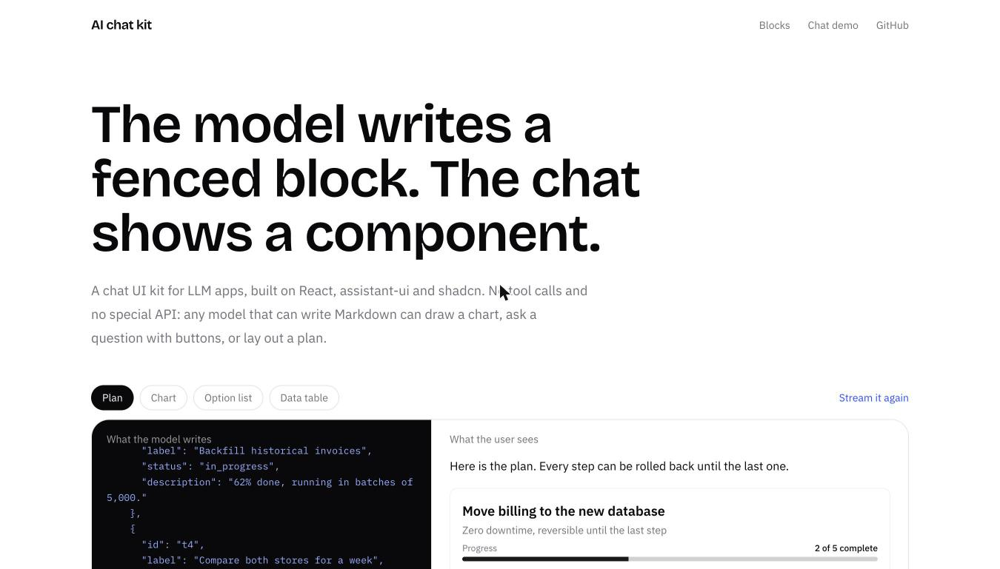
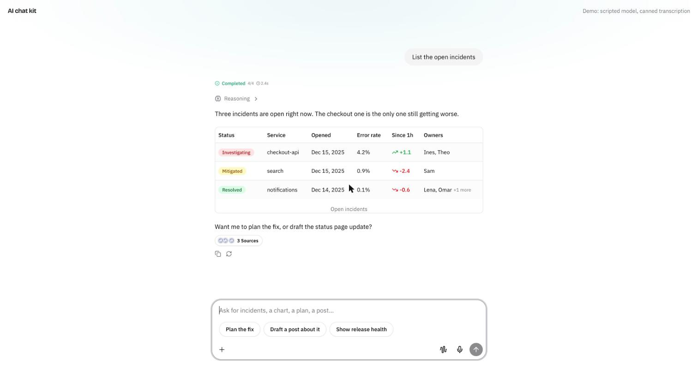
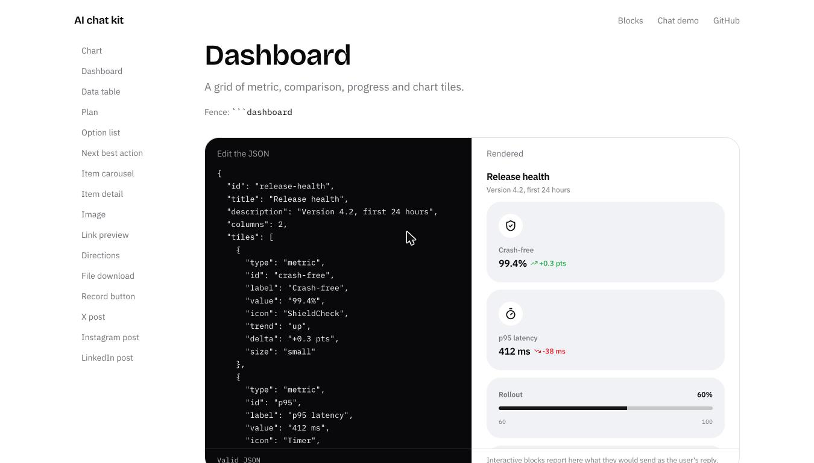

# AI chat kit

Chat UI for LLM apps. The model writes a fenced JSON block, the chat shows a component.

**[Live playground](https://hackarim.github.io/ai-chat-kit/)** · [Blocks](https://hackarim.github.io/ai-chat-kit/blocks/plan/) · [Chat demo](https://hackarim.github.io/ai-chat-kit/chat/)



````
Here is the plan. Every step can be rolled back until the last one.

```plan
{ "title": "Move billing to the new database", "todos": [ ... ] }
```
````

No tool calls and no special API. Any model that can write Markdown can draw a chart,
ask a question with buttons or lay out a plan. You paste a short contract into the
system prompt and the renderer does the rest.

Built on React 19, Next 16, [assistant-ui](https://github.com/assistant-ui/assistant-ui),
shadcn/ui and Tailwind 4.

## What you get

| | |
|---|---|
| **16 blocks** | Chart, dashboard, data table, plan, option list, next best action, item carousel, item detail, image, link preview, directions, file download, record button, and post previews for X, Instagram and LinkedIn. Each is a plain component with a forgiving parser and a prompt contract. |
| **Block renderer** | No chat runtime inside. Repairs the JSON slips models make, shows a skeleton while a block streams, and isolates a block that throws so the rest of the message survives. |
| **Chat thread** | Streaming Markdown, edits and branches, attachments, follow-up suggestions, reasoning that folds away, workflow steps with timings, sources, and auto-scroll that stops when the reader scrolls up. |
| **Voice** | Push to talk, and a hands-free mode with silence detection and barge-in: start speaking and the spoken reply stops. |



## Quick start

```bash
git clone https://github.com/hacKarim/ai-chat-kit.git
cd ai-chat-kit
npm install
npm run dev
```

Open http://localhost:3000. The playground runs on a scripted model
(`lib/demo/mock-model.ts`): no key, no network calls.

## Use a block

Install one with the shadcn CLI, or copy `components/tool-ui/<name>/`. Blocks depend
only on shadcn primitives.

```bash
npx shadcn@latest add https://hackarim.github.io/ai-chat-kit/r/plan.json
```

```tsx
import { BlockRenderer } from "@/components/tool-ui/block-renderer";

<BlockRenderer type="plan" code={jsonFromTheModel} send={(text) => sendUserMessage(text)} />
```

`send` is how interactive blocks (option list, next best action, carousel, record button)
answer on the user's behalf. Leave it out and they are display only.

Then add the contract from `prompts/components/plan.md` to your system prompt. Every
block page in the playground has its contract and a live JSON editor.



## Use the thread

```tsx
import { AssistantRuntimeProvider } from "@assistant-ui/react";
import { ChatKitProvider } from "@/lib/chat-kit";
import { Thread } from "@/components/assistant-ui/thread";

<AssistantRuntimeProvider runtime={runtime}>
  <ChatKitProvider
    welcome={{ title: "Hello.", subtitle: "How can I help today?" }}
    starters={[{ title: "Summarise", label: "this week's tickets", prompt: "Summarise this week's tickets" }]}
    transcribe={speechToText}   // (audio: File) => Promise<string>, enables the mic
    synthesize={textToSpeech}   // (text: string) => Promise<Blob>, enables playback
  >
    <Thread />
  </ChatKitProvider>
</AssistantRuntimeProvider>
```

The kit never calls your backend. Speech and suggestions are optional functions on the
provider, and the UI that needs a missing one hides itself. `runtime` is any
assistant-ui runtime.

Extra message data travels as data parts on the assistant message:

| Part name | Payload | Shows as |
|---|---|---|
| `workflow` | `WorkflowState` | step list with timings above the answer |
| `sources` | `Source[]` | favicon pile and a side sheet |
| `suggestions` | `string[]` | follow-up chips in the composer |

Types are in `lib/types.ts`.

## Add your own block

1. Create `components/tool-ui/my-block/` with the component and a parser that accepts loose input and returns clean props.
2. Register it in `components/tool-ui/registry.tsx`: fence name, aliases, `render`.
3. Write `prompts/components/my-block.md` and add it to your system prompt.
4. Run `npm run registry` to publish it to the shadcn registry.

## Project layout

```
components/tool-ui/        blocks, registry, block renderer
components/assistant-ui/   thread, Markdown, reasoning, sources, voice
components/ui/             shadcn primitives the kit uses
components/playground/     the demo site only
hooks/ contexts/ lib/      recorder with silence detection, adapters, types
prompts/components/        one contract per block
lib/demo/                  example payloads and the scripted model
```

## Scripts

| Command | Does |
|---|---|
| `npm run dev` | playground on localhost:3000 |
| `npm run build` | static export to `out/` |
| `npm run typecheck` | TypeScript, no emit |
| `npm run lint` | ESLint |
| `npm run registry` | rebuild `registry.json` and `public/r/` |

## Credits

The thread starts from the assistant-ui starter. The block folder layout and the
`Serializable` naming follow
[assistant-ui/tool-ui](https://github.com/assistant-ui/tool-ui) (MIT). UI primitives are
shadcn/ui.

## Licence

[MIT](LICENSE)
